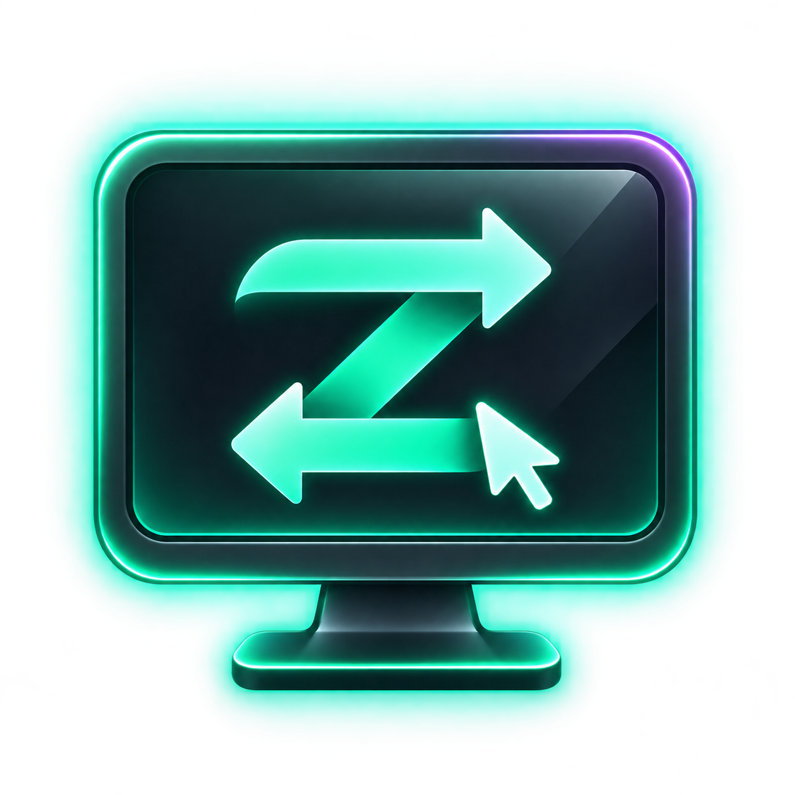
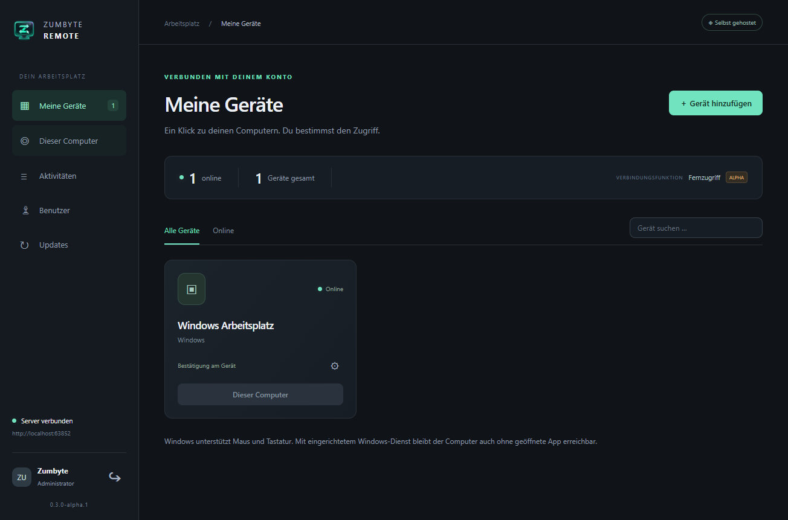
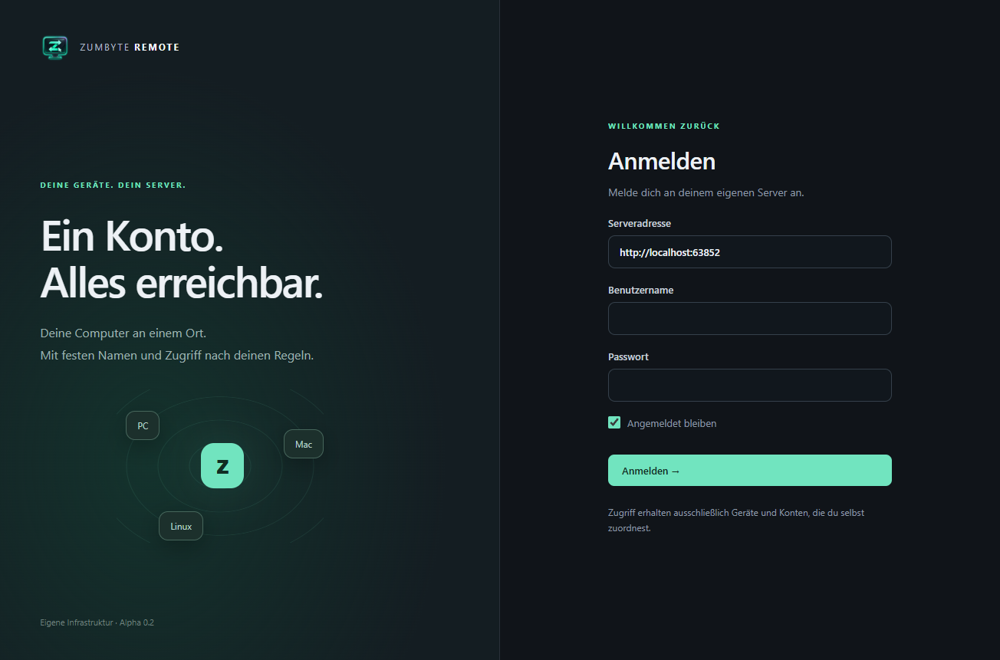
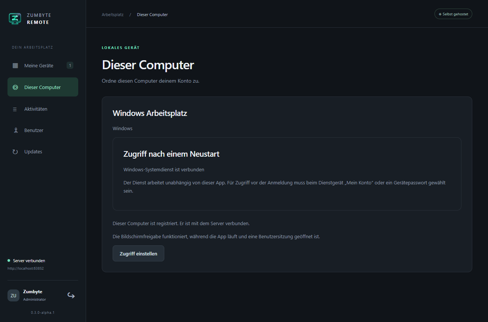

<p align="center"></p>
<h1 align="center">Zumbyte Remote</h1>
<p align="center">Deine Computer über deinen eigenen Server erreichen.</p>
<p align="center"><a href="https://github.com/ZUMBYTE-AppSolution/zumbyte-remote-release/releases/tag/v0.3.0-alpha.1">Downloads</a> · <a href="docs/UNRAID.md">Unraid</a> · <a href="docs/MACOS.md">Mac einrichten</a> · <a href="https://github.com/ZUMBYTE-AppSolution/zumbyte-remote-release/issues">Hilfe und Fehler</a></p>

Melde dich an deinem eigenen Server an und öffne einen Computer aus deiner Geräteliste. Für jedes Gerät wählst du, ob eine Person vor Ort bestätigen muss, deine zentrale Anmeldung genügt oder ein zusätzliches Gerätepasswort nötig ist.

**0.3.0-alpha.1** bringt Mac-Pakete, Hintergrundbetrieb, Vollbild mit einklappbarer Steuerleiste und Kopieren/Einfügen von Text und Dateien. Zuerst den Server, danach die beteiligten Desktop-Apps und Windows-Dienste aktualisieren.

## Herunterladen

| Für … | Download |
|---|---|
| Windows x64 | [Installer mit Desktopverknüpfung](https://github.com/ZUMBYTE-AppSolution/zumbyte-remote-release/releases/download/v0.3.0-alpha.1/ZumbyteRemote-Setup-0.3.0-alpha.1-windows-x64.exe) · [Portable ZIP](https://github.com/ZUMBYTE-AppSolution/zumbyte-remote-release/releases/download/v0.3.0-alpha.1/ZumbyteRemote-Portable-0.3.0-alpha.1-windows-x64.zip) |
| Mac mit Apple Silicon | [PKG installieren](https://github.com/ZUMBYTE-AppSolution/zumbyte-remote-release/releases/download/v0.3.0-alpha.1/ZumbyteRemote-Setup-0.3.0-alpha.1-macos-arm64.pkg) · [DMG](https://github.com/ZUMBYTE-AppSolution/zumbyte-remote-release/releases/download/v0.3.0-alpha.1/ZumbyteRemote-0.3.0-alpha.1-macos-arm64.dmg) |
| Mac mit Intel | [PKG installieren](https://github.com/ZUMBYTE-AppSolution/zumbyte-remote-release/releases/download/v0.3.0-alpha.1/ZumbyteRemote-Setup-0.3.0-alpha.1-macos-x64.pkg) · [DMG](https://github.com/ZUMBYTE-AppSolution/zumbyte-remote-release/releases/download/v0.3.0-alpha.1/ZumbyteRemote-0.3.0-alpha.1-macos-x64.dmg) |
| Docker / Unraid | Öffentliches Image: `ghcr.io/zumbyte-appsolution/zumbyte-remote-server:0.3.0-alpha.1` · [Einrichtung](docs/UNRAID.md) |
| Unraid Community Apps | [Vorlage und Anbieterprofil](docs/COMMUNITY-APPS.md) · [Dateipaket](https://github.com/ZUMBYTE-AppSolution/zumbyte-remote-release/releases/download/v0.3.0-alpha.1/ZumbyteRemote-Unraid-CommunityApps-0.3.0-alpha.1.zip) |
| Server ohne Container | [Node.js-24-Serverpaket](https://github.com/ZUMBYTE-AppSolution/zumbyte-remote-release/releases/download/v0.3.0-alpha.1/ZumbyteRemote-Server-0.3.0-alpha.1.tar.gz) |
| Imageimport / eigener Containerbau | [Imagearchiv Linux amd64](https://github.com/ZUMBYTE-AppSolution/zumbyte-remote-release/releases/download/v0.3.0-alpha.1/ZumbyteRemote-DockerImage-0.3.0-alpha.1-linux-amd64.tar.gz) · [Docker-/Unraid-Paket](https://github.com/ZUMBYTE-AppSolution/zumbyte-remote-release/releases/download/v0.3.0-alpha.1/ZumbyteRemote-Unraid-Docker-0.3.0-alpha.1.zip) |

[Prüfsummen](https://github.com/ZUMBYTE-AppSolution/zumbyte-remote-release/releases/download/v0.3.0-alpha.1/SHA256SUMS.txt) · [Änderungen](CHANGELOG.md)

Windows-Pakete enthalten die benötigten Laufzeiten. Die Mac-Ausgabe benötigt macOS 13 oder neuer. Windows-Pakete haben noch keine Authenticode-Signatur; die Mac-Pakete sind noch nicht mit einer Apple-Developer-ID signiert oder notarisiert. Die integrierte Updateprüfung prüft ihre eigene Signatur und SHA-256. Mac-Berechtigungen und Fernsteuerung benötigen noch Praxistests auf echten Macs.

## Die App



| Anmeldung | Diesen Computer einrichten |
|---|---|
|  |  |

Die Bilder zeigen die laufende App.

## Verbinden

1. Server starten und eine eigene HTTPS-Adresse mit WebSocket-Unterstützung einrichten.
2. Die Adresse im Browser öffnen. Den einmaligen Code aus `/data/setup-token.txt` eingeben und das erste Administratorkonto anlegen.
3. Desktop-App installieren, dieselbe Serveradresse eintragen und anmelden.
4. Unter **Dieser Computer** den Computer deinem Konto zuordnen. Er bekommt einen festen Eintrag in der Geräteliste.
5. Für unbeaufsichtigten Zugriff den Hintergrunddienst einrichten und die gewünschte Zugriffsregel wählen.

Weitere Konten werden unter **Benutzer** angelegt. Jedes Konto sieht seine eigenen Computer.

| Einstellung | Beim Verbinden |
|---|---|
| **Bestätigung am Gerät** | Die Person am Zielcomputer erlaubt den Zugriff. |
| **Mein Konto / kein weiteres Passwort** | Deine zentrale Anmeldung genügt; es erscheint keine zusätzliche Freigabemaske. |
| **Gerätepasswort** | Zusätzlich zur zentralen Anmeldung wird das Gerätepasswort abgefragt. |

## Während der Verbindung

Jede Verbindung öffnet ein eigenes Fenster. Ins Bild klicken, um zu steuern. **Pos1 / Home** gibt Maus und Tastatur lokal frei. Der Monitorplan zeigt die Anordnung der Bildschirme mit Nummern; ein Klick wechselt den Monitor. Mit dem Pfeil geht es zum nächsten Bildschirm.

**Vollbild** verwendet ein eigenes Vollbildfenster mit schwebender einklappbarer Leiste. Dort stehen Monitorwahl, Auflösungsgrenze, Bildqualität, 1:1, Zwischenablage, Dateien und Trennen bereit. Die Auflösungsgrenze verändert die Übertragung, nicht die Anzeigeeinstellung des Zielcomputers.

In den aktuellen Desktop-Apps lassen sich **Text und mehrere Dateien in beide Richtungen** kopieren und einfügen. Strg+C/V beziehungsweise Cmd+C/V verwenden oder die Schaltflächen in der Leiste wählen. **Dateien senden** öffnet eine Dateiauswahl. Fortschritt und Fehler werden im Verbindungsfenster angezeigt. Ordner werden noch nicht übertragen. Die Zwischenablage ist für die angemeldete Desktop-Sitzung vorgesehen.

Die native Tastaturübernahme gilt für die fokussierte Desktop-Verbindung. Betriebssystemreservierte Sicherheitsfolgen bleiben eine Ausnahme; **Strg + Alt + Entf** über die eigene Schaltfläche an das Windows-Dienstgerät senden. Im Browser stehen die nativen Datei-/Zwischenablagefunktionen und die Übernahme von Systemtastenkombinationen nicht zur Verfügung.

## Im Hintergrund erreichbar bleiben

**Windows:** Das Schließen des Hauptfensters lässt die App im Infobereich weiterlaufen. Von dort lässt sie sich wieder öffnen. Der optionale Systemdienst startet mit Windows und arbeitet unabhängig vom Hauptfenster. Er hat eine eigene Gerätezuordnung und unterstützt den Anmelde-/Sicherheitsdesktop. Windows-Anmeldedaten werden direkt in Windows eingegeben; Zumbyte Remote speichert kein Windows-Passwort und richtet kein Autologin ein.

**Mac:** Der Benutzer-LaunchAgent hält die App im Hintergrund erreichbar und startet sie nach der Anmeldung. Bildschirmaufnahme und Bedienungshilfen müssen in macOS freigegeben werden. Der Mac-Anmeldebildschirm und FileVault sind in dieser Alpha nicht enthalten. [Mac-Anleitung](docs/MACOS.md).

## Unraid und Community Apps

Das Image kann ohne Anmeldung geladen werden:

```sh
docker pull ghcr.io/zumbyte-appsolution/zumbyte-remote-server:0.3.0-alpha.1
```

Konten, Geräte und Anwendungsupdates bleiben im Appdata-Ordner. Der Container benötigt weder privilegierten Modus noch Docker-Socket. Die Vorlage erlaubt auch eine eigene br0-Adresse; bestehende IP-Adressen werden nicht geändert. [Unraid-Anleitung](docs/UNRAID.md).

Für Community Apps liegen **[ca_profile.xml](ca_profile.xml)** und **[templates/zumbyte-remote.xml](templates/zumbyte-remote.xml)** bereit. Die Vorlage enthält Icon, Beschreibung, Supportlinks, Port und Konfiguration. Die Aufnahme in den CA-Katalog erfolgt nach eigener Einreichung und Prüfung durch Unraid. [Dateien und Einreichung](docs/COMMUNITY-APPS.md).

## Updates

App und Server lesen den öffentlichen GitHub-Release-Feed und laden die passenden Dateien direkt. Dafür sind weder GitHub-API noch GitHub-Token nötig. Vor der Installation werden Signatur, Größe und SHA-256 geprüft.

Unter **Updates** wird das passende Installationspaket gestartet. Profile und Gerätezuordnung bleiben erhalten. Die Containeranwendung kann neue Versionen automatisch übernehmen; `AUTO_UPDATE` ist in der Vorlage umschaltbar. Änderungen der Linux-/Node.js-Basis kommen über ein neues Containerimage. [Update-Anleitung](docs/UPDATES.md).

## ServerDesk

Das [Remote-Plugin für ServerDesk](https://github.com/ZUMBYTE-AppSolution/serverdesk-plugins) ist als eigenes Downloadpaket erhältlich. Es benötigt eine kompatible ServerDesk-Version. Die Integration in ServerDesk ist noch nicht abschließend geprüft.

Dies bleibt eine Alpha. Native Linux-Desktopsteuerung, Ordnerübertragung, MFA und weitere Praxistests stehen aus. Die Lizenz für Vorlagen und Dokumentation gilt nicht automatisch für die heruntergeladenen Anwendungsdateien.

**Zumbyte – AppSolution · [www.zumbyte.de](https://www.zumbyte.de/)**
