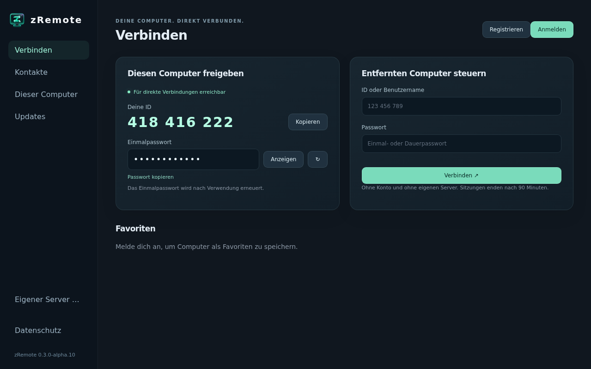
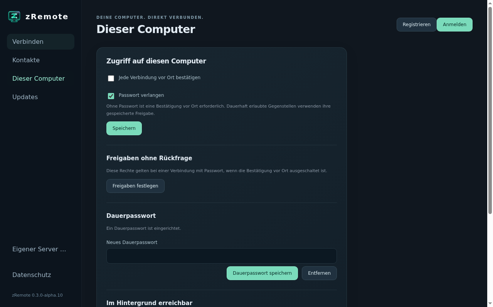
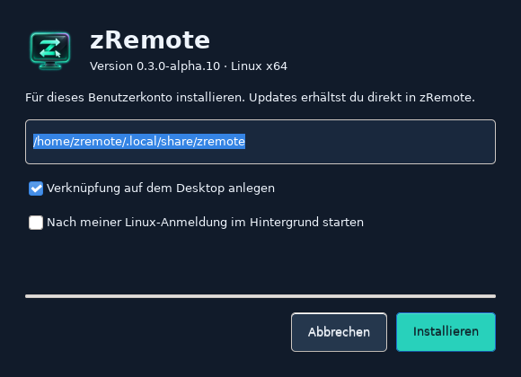

<h1 align="center">zRemote</h1>

Computer über ID und Passwort direkt verbinden.

<a href="https://github.com/ZUMBYTE-AppSolution/zumbyte-remote-release/releases/tag/v0.3.0-alpha.10">Downloads</a> · <a href="docs/WINDOWS-SCHNELLSTART.txt">Windows</a> · <a href="docs/MACOS.md">Mac</a> · <a href="docs/LINUX.md">Linux</a> · <a href="docs/UNRAID.md">Unraid</a> · <a href="https://github.com/ZUMBYTE-AppSolution/zumbyte-remote-release/issues">Hilfe und Fehler</a>

zRemote zeigt dir eine feste neunstellige ID und ein Einmalpasswort. Gib beides am anderen Computer ein und wähle am Zielgerät aus, was erlaubt sein soll. Ein Konto und ein eigener Server sind dafür optional. Mit einem Zumbyte-Konto kommen ein Verbindungsname, Freunde und Favoriten hinzu.

**0.3.0 Alpha 10** behebt eine Sperre, die das erneute Öffnen der App verhindern konnte. ID-Verbindungen ohne Registrierung, einzelne Freigaben und die Linux-App sind enthalten. Portable und installierte Ausgabe verwenden beim selben Benutzer dieselbe Gerätezuordnung. Die öffentliche Vermittlung tauscht Verbindungsangebote aus; Bild, Eingaben, Chat und Dateien laufen direkt zwischen den Computern.

## Herunterladen

**Linux-RPM Revision 3:** Der Systemdienst nimmt den Bildschirm auf GamerZ OS direkt auf. Bei eingerichtetem Kontozugriff ist keine Annahme vor Ort erforderlich. Die Verbindung nutzt das kleine Freigabefenster wie unter Windows und macOS. Im AppStore die Quelle aktualisieren und `linux-x86_64-r3.rpm` wählen. Die App zeigt weiterhin Alpha 10; die Paketverwaltung erkennt Revision 3. Andere Linux-Downloads bleiben unverändert. [Dienst einrichten und Voraussetzungen prüfen](docs/LINUX.md).

| Für … | Download |
|---|---|
| Windows x64 | [Installer mit Desktopverknüpfung](https://github.com/ZUMBYTE-AppSolution/zumbyte-remote-release/releases/download/v0.3.0-alpha.10/ZumbyteRemote-Setup-0.3.0-alpha.10-windows-x64.exe) · [Portable ZIP](https://github.com/ZUMBYTE-AppSolution/zumbyte-remote-release/releases/download/v0.3.0-alpha.10/ZumbyteRemote-Portable-0.3.0-alpha.10-windows-x64.zip) |
| Mac mit Apple Silicon | [PKG](https://github.com/ZUMBYTE-AppSolution/zumbyte-remote-release/releases/download/v0.3.0-alpha.10/ZumbyteRemote-Setup-0.3.0-alpha.10-macos-arm64.pkg) · [DMG](https://github.com/ZUMBYTE-AppSolution/zumbyte-remote-release/releases/download/v0.3.0-alpha.10/ZumbyteRemote-0.3.0-alpha.10-macos-arm64.dmg) |
| Mac mit Intel | [PKG](https://github.com/ZUMBYTE-AppSolution/zumbyte-remote-release/releases/download/v0.3.0-alpha.10/ZumbyteRemote-Setup-0.3.0-alpha.10-macos-x64.pkg) · [DMG](https://github.com/ZUMBYTE-AppSolution/zumbyte-remote-release/releases/download/v0.3.0-alpha.10/ZumbyteRemote-0.3.0-alpha.10-macos-x64.dmg) |
| Linux x86_64 · Intel/AMD | [RPM Revision 3 für Fedora / GamerZ OS](https://github.com/ZUMBYTE-AppSolution/zumbyte-remote-release/releases/download/v0.3.0-alpha.10/ZumbyteRemote-Setup-0.3.0-alpha.10-linux-x86_64-r3.rpm) · [Grafischer Installer (.run)](https://github.com/ZUMBYTE-AppSolution/zumbyte-remote-release/releases/download/v0.3.0-alpha.10/ZumbyteRemote-Setup-0.3.0-alpha.10-linux-x64.run) · [DEB](https://github.com/ZUMBYTE-AppSolution/zumbyte-remote-release/releases/download/v0.3.0-alpha.10/ZumbyteRemote-Setup-0.3.0-alpha.10-linux-x64-r2.deb) · [Portable TAR.GZ](https://github.com/ZUMBYTE-AppSolution/zumbyte-remote-release/releases/download/v0.3.0-alpha.10/ZumbyteRemote-Portable-0.3.0-alpha.10-linux-x64-universal.tar.gz) |
| Linux ARM64 · auch Raspberry Pi mit 64-Bit-System | [Grafischer Installer (.run)](https://github.com/ZUMBYTE-AppSolution/zumbyte-remote-release/releases/download/v0.3.0-alpha.10/ZumbyteRemote-Setup-0.3.0-alpha.10-linux-arm64.run) · [DEB](https://github.com/ZUMBYTE-AppSolution/zumbyte-remote-release/releases/download/v0.3.0-alpha.10/ZumbyteRemote-Setup-0.3.0-alpha.10-linux-arm64.deb) · [Portable TAR.GZ](https://github.com/ZUMBYTE-AppSolution/zumbyte-remote-release/releases/download/v0.3.0-alpha.10/ZumbyteRemote-Portable-0.3.0-alpha.10-linux-arm64.tar.gz) |
| Eigener Server auf Docker / Unraid | `ghcr.io/zumbyte-appsolution/zumbyte-remote-server:alpha` · [Einrichtung](docs/UNRAID.md) |
| Unraid Community Apps | [Vorlage und Anbieterprofil](docs/COMMUNITY-APPS.md) · [Dateipaket](https://github.com/ZUMBYTE-AppSolution/zumbyte-remote-release/releases/download/v0.3.0-alpha.10/ZumbyteRemote-Unraid-CommunityApps-0.3.0-alpha.10.zip) |
| Server ohne Container | [Node.js-24-Serverpaket](https://github.com/ZUMBYTE-AppSolution/zumbyte-remote-release/releases/download/v0.3.0-alpha.10/ZumbyteRemote-Server-0.3.0-alpha.10.tar.gz) |
| Imageimport / Containerkonfiguration | [Imagearchiv Linux amd64](https://github.com/ZUMBYTE-AppSolution/zumbyte-remote-release/releases/download/v0.3.0-alpha.10/ZumbyteRemote-DockerImage-0.3.0-alpha.10-linux-amd64.tar.gz) · [Docker-/Unraid-Paket](https://github.com/ZUMBYTE-AppSolution/zumbyte-remote-release/releases/download/v0.3.0-alpha.10/ZumbyteRemote-Unraid-Docker-0.3.0-alpha.10.zip) |

[Linux-Prüfsummen](https://github.com/ZUMBYTE-AppSolution/zumbyte-remote-release/releases/download/v0.3.0-alpha.10/SHA256SUMS-linux.txt) · [Weitere Prüfsummen](https://github.com/ZUMBYTE-AppSolution/zumbyte-remote-release/releases/download/v0.3.0-alpha.10/SHA256SUMS.txt) · [Änderungen](CHANGELOG.md) · [zRemote für ServerDesk](https://github.com/ZUMBYTE-AppSolution/serverdesk-plugins) · [Lizenzen der Linux-Komponenten](docs/LINUX-LIZENZEN.txt)

Windows-Pakete enthalten die benötigten Laufzeiten und sind digital signiert. Mac-Pakete sind mit Developer ID signiert und bei Apple notarisiert; macOS 13 oder neuer wird benötigt. Für Linux gibt es jetzt grafische Installer für x64 und ARM64. Sie installieren zRemote für dein Benutzerkonto, tragen die App im Menü ein und können eine Desktopverknüpfung anlegen. Unterstützt werden aktuelle glibc-Desktops ab glibc 2.35; die [Linux-Anleitung](docs/LINUX.md) nennt Voraussetzungen und Installationsschritte. Der Anmeldeschlüsselbund muss verfügbar sein. ARM64 ist als Vorschau enthalten; ein Test auf einem echten Raspberry Pi steht noch aus.

## Die App

Die Bilder zeigen zRemote unter Linux.

## Erste Verbindung

1. Auf beiden Computern eine aktuelle zRemote-App öffnen.
2. Am Zielcomputer ID und Einmalpasswort ablesen. Alternativ unter **Dieser Computer** ein Dauerpasswort festlegen.
3. Am steuernden Computer unter **Verbinden** ID oder Verbindungsname und Passwort eingeben.
4. Die Anfrage am Zielcomputer annehmen und die gewünschten Funktionen freigeben.

Die ID bleibt an die geschützte Geräteidentität gebunden. Für die Verbindung ist keine Registrierung erforderlich. Wer sich anmeldet, kann einen Verbindungsnamen anlegen und Computer als Freunde oder Favoriten speichern. Die Kontosicherheit und Zwei-Faktor-Anmeldung verwaltest du über dein Zumbyte-Konto.

## Freigaben bestimmen

Im Annahmedialog wählst du Bild, Maus, Tastatur, Zwischenablage, Dateien, Chat und verfügbaren Ton. **Präsentationsmodus** erlaubt nur die Bewegung des Mauszeigers; Klicks und Tastatureingaben sind gesperrt. Über **Immer erlauben** lässt sich eine Gegenstelle mit ausdrücklich gewählten Rechten speichern. Unter **Kontakte** können diese Rechte später geändert oder entfernt werden.

Auf dem ferngesteuerten Computer bleibt ein kleines, minimierbares Fenster zum Ändern der Rechte und Trennen der Verbindung. Unter **Dieser Computer** lässt sich die Bestätigung vor Ort ausschalten, wenn ein Passwort verlangt wird. Die dort gespeicherten Freigaben gelten dann für Verbindungen mit Passwort.

## Während der Verbindung

Jede Verbindung öffnet ein eigenes Fenster. Klicke ins Bild, um zu steuern. **Pos1 / Home** gibt Maus und Tastatur auf deinem Computer wieder frei; auf Mac-Tastaturen ohne Home gewöhnlich **fn + Pfeil links**.

Die einzeilige Steuerleiste blendet sich automatisch aus und erscheint wieder, wenn die Maus den Bildschirmrand mittig erreicht. Mit der Stecknadel bleibt sie sichtbar; am Griff lässt sie sich verschieben. Die Monitorübersicht zeigt Anordnung und Nummern der Bildschirme. Ein Klick oder der Weiter-Pfeil wechselt den Bildschirm.

Unter **Darstellung und Qualität** kannst du das Bild einpassen, in Originalgröße anzeigen oder die unterstützte Auflösung des Zielcomputers an die Fenstergröße anpassen. Falls ein Wechsel nicht möglich ist, bleibt das vollständige Bild proportional eingepasst. Bei geöffnetem MacBook oder aktiver, entsperrter Mac-Sitzung wird die Bildschirmauflösung nicht verändert. Einstellungen für Bild, Ton und Eingaben bleiben je Gegenstelle gespeichert und lassen sich zurücksetzen.

Text und einzelne Dateien lassen sich in beide Richtungen über die freigegebene Zwischenablage übertragen. Im **Chat** stehen Sprechblasen, anklickbare Links und Dateianhänge mit Fortschritt zur Verfügung. **Speichern …** legt einen empfangenen Anhang gezielt ab, ohne die Zwischenablage zu überschreiben. Ordnerübertragung ist noch nicht enthalten.

Bei einem Verbindungsabbruch zeigt ein Countdown den nächsten Versuch. Schließen des Fensters beendet diese Versuche. Öffentliche ID-Verbindungen enden nach 90 Minuten; Wiederverbindungen verlängern diese Frist nicht. Der korrigierte Linux-Client setzt für Verbindungen über einen eigenen Server kein solches Zeitlimit. Ältere Server oder Gegenstellen können weiterhin nach 90 Minuten trennen und benötigen ebenfalls eine korrigierte Ausgabe.

## Im Hintergrund erreichbar

Unter Windows den **Hintergrunddienst** einrichten und eine passende Passwort- oder dauerhafte Freigabe festlegen. Der Dienst startet mit Windows und ermöglicht den Zugriff am Anmeldebildschirm und bei der Benutzerkontensteuerung. Die Windows-Anmeldung bleibt erforderlich. Der Dienst speichert keine Windows-Kennwörter. Ton und Mikrofon sind bei dienstgestützten Verbindungen noch nicht verfügbar.

Der Mac-Hintergrunddienst und der Linux-Hintergrundstart laufen in der angemeldeten Benutzersitzung. Ein Zugriff vor der Mac-/Linux-Anmeldung oder auf die FileVault-Entsperrung ist nicht enthalten.

Unter Linux ist die vollständige Mehrmonitorsteuerung für X11 vorgesehen. Wayland ist experimentell, verlangt Systemfreigaben und bietet bei mehreren angeschlossenen Bildschirmen zunächst nur die Ansicht. Die [Linux-Anleitung](docs/LINUX.md) beschreibt die Unterschiede.

## Eigener Server und Unraid

Für eine eigene Anmeldung und Geräteliste kannst du zusätzlich den Server betreiben. In der App dafür **Eigener Server …** wählen. [Unraid einrichten](docs/UNRAID.md) · [Server ohne Container](docs/SERVER.md)

In Unraid das Repository `ghcr.io/zumbyte-appsolution/zumbyte-remote-server:alpha` verwenden und über **Docker → Auf Updates prüfen → Update** aktualisieren. Appdata, Konten, Gerätezuordnungen und eigene IP-Einstellungen bleiben erhalten. Der Container benötigt weder privilegierten Modus noch Docker-Socket.

## Updates und Datenschutz

Unter **Updates** neue Versionen prüfen. Die App zeigt Downloadfortschritt und bleibende Fehler an. Der Updater verwendet den öffentlichen GitHub-Release-Feed, direkte Paketdateien, eine Signaturprüfung und SHA-256. Ein GitHub-Token ist nicht nötig. [Mehr zu Updates](docs/UPDATES.md)

Die öffentliche Vermittlung überträgt Verbindungsangebote und keine Sitzungsinhalte. Router- oder Firewallbeschränkungen können eine direkte Verbindung verhindern. Es gibt keinen Ersatzweg über die Zumbyte-Vermittlung für Bildschirm, Chat oder Dateien. [Datenschutz für zRemote](https://zumbyte.de/zRemote/datenschutz/)
